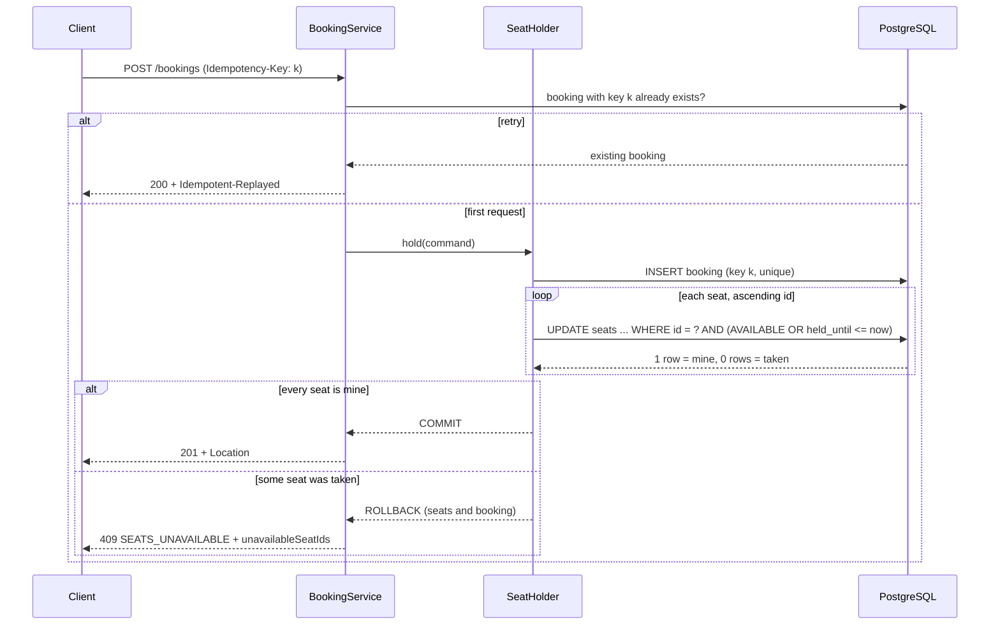

# Seat Reservation

Reserved-seating ticket API: hold seats for a few minutes while the customer checks out, without ever giving the same seat to two people.

[](https://github.com/Tutzdev/seat-reservation/actions/workflows/ci.yml)


> Work in progress, built in phases. Phase 1 (this one) is the seat inventory: events, seat maps, holds and their expiry. Payment through [wallet-ledger](https://github.com/Tutzdev/wallet-ledger) comes next. See the [roadmap](#roadmap).

## The problem

A ticket sale looks like `if (seat.isFree()) seat.sell()`. Then the sale opens:

- Two thousand people click the same seat in the same second. The check passes for many of them before anyone writes, and the seat is sold more than once.
- Someone holds four seats and closes the tab. The seats have to go back on sale by themselves, and quickly, because the show sells out in minutes.
- A buyer picks seats 12 and 13, but 13 was just taken. Holding only 12 is worse than holding nothing.
- The mobile app times out and retries. The customer now has two holds and blocks twice as many seats.
- Two requests for overlapping seats lock rows in opposite order and deadlock each other.

## Backend highlights

- **A conditional UPDATE is the whole concurrency control.** `UPDATE seats SET status = 'HELD' ... WHERE id = ? AND status = 'AVAILABLE'` returns 1 for the winner and 0 for everyone else. A transaction waiting on the row lock re-checks the `WHERE` after the winner commits. No `SELECT ... FOR UPDATE`, no version column, no retry loop.
- **All or nothing.** Seats are claimed one by one inside a single transaction; if any is taken, the request answers `409 SEATS_UNAVAILABLE` with the taken ids and everything rolls back.
- **No deadlocks.** Seats are always claimed in ascending id order, so overlapping requests wait for each other instead of locking in a cycle. A test fires 60 overlapping requests in random order to prove it.
- **Abandoned holds free their seats the moment they expire.** The hold `UPDATE` also matches seats whose `held_until` has passed. A background sweeper marks old holds as `EXPIRED` in batches with `FOR UPDATE SKIP LOCKED`, but correctness never waits for it.
- **Idempotent holds.** `POST /bookings` requires an `Idempotency-Key`. A retry returns the original booking (`200` + `Idempotent-Replayed: true`); the same key with other seats is rejected. Concurrent retries meet on a unique constraint.
- **The database guards its own invariants.** A `CHECK` constraint ties `status`, `booking_id` and `held_until` together, so a seat can never be `HELD` without an owner and a deadline.
- **Time is injected.** Every "now" comes from a `Clock`. Tests move a mutable clock past the deadline instead of sleeping.
- **Errors as Problem Details (RFC 9457)** with a stable `code` (`SEATS_UNAVAILABLE`, `EVENT_STARTED`, `IDEMPOTENCY_KEY_REUSED`...) and field-level validation errors.

## Business rules

| Rule | Where it is enforced | Error code |
| --- | --- | --- |
| A seat is held by at most one booking at a time | Conditional `UPDATE` in `SeatRepository.hold` | `SEATS_UNAVAILABLE` (409) |
| A booking gets every requested seat or none | One transaction in `SeatHolder`, rolled back on the first lost seat | `SEATS_UNAVAILABLE` (409) |
| A hold lasts 10 minutes; after that its seats are free for anyone | `held_until <= now` in the hold `UPDATE`, `Booking.statusAt` | n/a |
| At most 6 seats per booking, each at most once | `SeatHolder` | `TOO_MANY_SEATS`, `DUPLICATE_SEAT` (422) |
| Every seat must belong to the event | `SeatHolder` | `UNKNOWN_SEAT` (422) |
| No holds once the event has started | `Event.hasStarted` | `EVENT_STARTED` (422) |
| Cancelling twice is harmless; an expired hold cannot be cancelled | `Booking.cancel` | `BOOKING_NOT_ACTIVE` (409) |
| An Idempotency-Key is bound to one request | `BookingService` + `UNIQUE (idempotency_key)` | `IDEMPOTENCY_KEY_REUSED` (422) |
| A seat map has unique section names and unique rows per section, up to 20,000 seats | `SeatLayout` | `DUPLICATE_SECTION`, `DUPLICATE_ROW`, `TOO_MANY_SEATS` (422) |
| Events start in the future | `Event.schedule` | `EVENT_IN_THE_PAST` (422) |
| `HELD` ⇔ the seat has a booking and a deadline | `CHECK` constraint (`V2` migration) | n/a |

## How a hold works



The booking row is inserted **before** any seat is touched. Two concurrent retries with the same key therefore collide on the unique index and never compete for the seats; the loser rolls back and returns the winner's booking.

```
src/main/java/dev/tutz/reservation
├── event      Event, Seat, SeatLayout (seat map rules), seat map and availability queries
├── booking    Booking aggregate, SeatHolder (write path), BookingService (idempotency), HoldExpirySweeper
└── common     Problem Details handler, Clock, paging, OpenAPI
```

## API

OpenAPI UI: `/swagger-ui.html`.

| Method | Path | Description |
| --- | --- | --- |
| `POST` | `/api/v1/events` | Create an event and generate its seat map from sections |
| `GET` | `/api/v1/events` | Upcoming events (paginated) |
| `GET` | `/api/v1/events/{id}` | Event with seats and available seats per section |
| `GET` | `/api/v1/events/{id}/seats` | Seat map with each seat's status, optionally `?section=` |
| `POST` | `/api/v1/bookings` | Hold seats (requires `Idempotency-Key`) |
| `GET` | `/api/v1/bookings/{id}` | One booking with its seats and price |
| `POST` | `/api/v1/bookings/{id}/cancel` | Cancel a hold and release its seats |

```bash
curl -X POST localhost:8080/api/v1/events -H "Content-Type: application/json" -d '{
  "name": "Rock in Rio", "venue": "Parque Olímpico", "startsAt": "2027-09-12T20:00:00Z",
  "sections": [
    {"name": "Floor", "rows": ["A", "B", "C"], "seatsPerRow": 20, "priceCents": 45000},
    {"name": "Upper", "rows": ["D", "E"], "seatsPerRow": 30, "priceCents": 20000}
  ]}'

curl -X POST localhost:8080/api/v1/bookings \
  -H "Idempotency-Key: checkout-7f3a9c21" \
  -H "Content-Type: application/json" \
  -d '{"eventId": "…", "seatIds": [101, 102]}'
```

```json
{
  "type": "about:blank",
  "title": "Conflict",
  "status": 409,
  "detail": "Some of the requested seats are no longer available.",
  "instance": "/api/v1/bookings",
  "code": "SEATS_UNAVAILABLE",
  "unavailableSeatIds": [102],
  "timestamp": "2026-10-14T03:21:07.512Z"
}
```

## Technical decisions

- **Conditional UPDATE instead of `SELECT ... FOR UPDATE` or `@Version`.** With a pessimistic read lock, the check and the write are two statements and the lock is easy to forget on a new code path. With optimistic versioning, 1,999 of 2,000 buyers get an exception and the client has to retry for nothing. The conditional UPDATE does the check and the write atomically, and the row count is the answer.
- **The seat row is the single source of truth for who holds it now.** `bookings` records what was asked for, `booking_seats` keeps an immutable copy of each line and price, and `seats.booking_id` says who owns the seat at this moment. When an expired hold is taken over, the old booking keeps its history and the seat simply points elsewhere.
- **Lazy expiry plus a sweeper, not a sweeper alone.** If only a background job released seats, every expired seat would stay blocked until the next run, which is exactly when demand peaks. Treating `held_until <= now` as free makes expiry exact; the sweeper only keeps the stored status honest for reports.
- **Failed holds are not remembered by the idempotency key.** A hold that lost a seat rolls back, key included, so the client can retry the same request once the seat frees up. Only successful holds are replayed.
- **Seats reference events by id, not through a JPA association.** An event can have 20,000 seats and nothing should ever load them through the event. They are inserted in JDBC batches of 100 with a pooled sequence, so creating an event is a few round trips instead of one per seat.
- **Amounts are `long` cents.** No floating point anywhere near money.

## Tests

```bash
./mvnw verify   # needs Docker for Testcontainers
```

- `BookingConcurrencyTests`: 100 virtual threads released by the same latch race for one seat, and exactly one wins. Sixty requests for random overlapping sets of three seats finish without a deadlock, and no seat ends up in two bookings.
- `IdempotentHoldTests`: a retry returns the original booking, a reused key with other seats is rejected, 20 concurrent retries create one booking, and a hold that lost its seats can be retried with the same key.
- `HoldExpiryTests`: an expired hold frees its seats before the sweeper runs, the sweeper never touches a seat another booking took over, and active holds are left alone.
- `BookingApiTests` / `EventApiTests`: the HTTP contract, meaning status codes, `Location` and `Idempotent-Replayed` headers, and Problem Details bodies.
- `BookingServiceTests`, `EventServiceTests`, `SeatLayoutTests`: all-or-nothing holds, cancel, limits and seat map rules.

The integration tests run against PostgreSQL 17 in Testcontainers, because row locks, `SKIP LOCKED` and the `CHECK` constraints cannot be faked by an in-memory database. CI runs everything on every push.

## Running locally

```bash
docker compose up --build    # PostgreSQL + API on :8080
```

Without Docker for the app, start only the database and run the API from Maven:

```bash
docker compose up -d postgres
./mvnw spring-boot:run
```

Hold duration, seat limits and the sweeper are configured under `reservation.*` in `application.yml`.

## Roadmap

- **Phase 2: payment.** Confirm a booking by paying through [wallet-ledger](https://github.com/Tutzdev/wallet-ledger), with the booking id as the `Idempotency-Key`. Consume the ledger's transfer events from Kafka with an inbox table that drops duplicates. If the payment lands after the hold expired, reverse it (a compensating step).
- **Phase 3: customers.** JWT authentication, idempotency keys scoped per customer, one active hold per customer per event.
- **Phase 4: sale opening.** A virtual waiting room in Redis and rate limiting per customer.
- **Phase 5: proof under load.** A k6 scenario with thousands of buyers on one section, Micrometer metrics for won and lost holds, and OpenTelemetry tracing across this service and the ledger.
