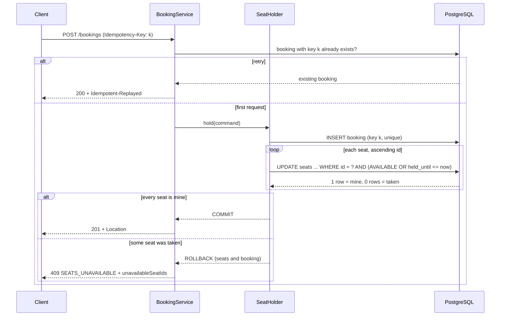
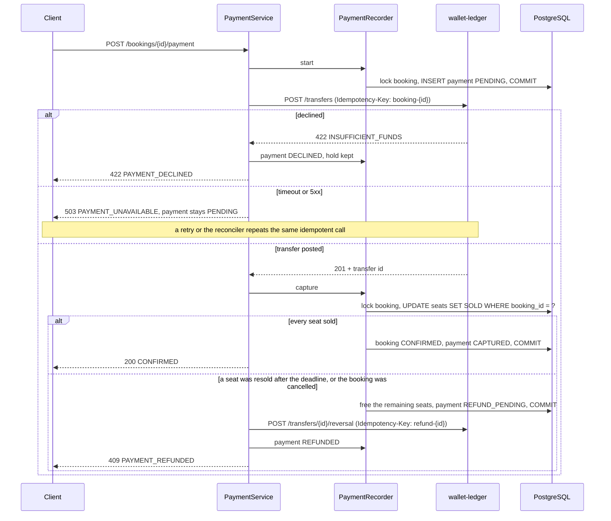
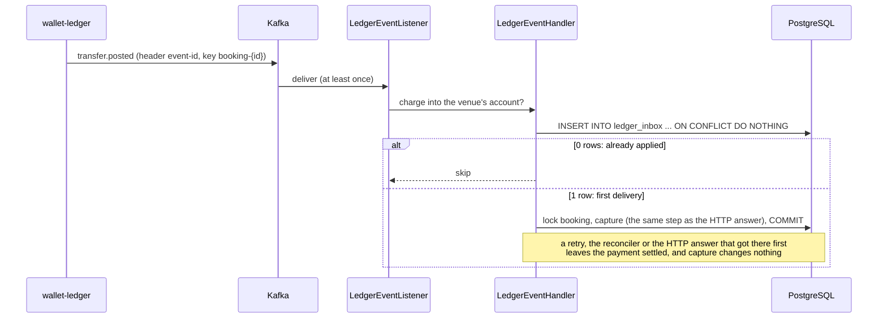

# Seat Reservation

Reserved-seating ticket API: hold seats for a few minutes while the customer checks out, without ever giving the same seat to two people.

[](https://github.com/Tutzdev/seat-reservation/actions/workflows/ci.yml)


> Built in phases. Phase 1 is the seat inventory: events, seat maps, holds and their expiry. Phase 2 pays for a hold through [wallet-ledger](https://github.com/Tutzdev/wallet-ledger), another project of mine, and sells the seats. Phase 2.5 listens to the ledger's transfer events on Kafka, so a payment the ledger posted is settled here at once, even when its HTTP answer was lost. Phase 3 (current) adds customers: JWT login, bookings that belong to whoever made them, one hold per customer per event, and refunds on request. See the [roadmap](#roadmap).

## The problem

A ticket sale looks like `if (seat.isFree()) seat.sell()`. Then the sale opens:

- Two thousand people click the same seat in the same second. The check passes for many of them before anyone writes, and the seat is sold more than once.
- Someone holds four seats and closes the tab. The seats have to go back on sale by themselves, and quickly, because the show sells out in minutes.
- A buyer picks seats 12 and 13, but 13 was just taken. Holding only 12 is worse than holding nothing.
- The mobile app times out and retries. The customer now has two holds and blocks twice as many seats.
- Two requests for overlapping seats lock rows in opposite order and deadlock each other.
- The payment request times out. Did the money move? Retrying may charge twice; not retrying may lose a paid sale.
- The payment lands one second after the hold expired, and someone else just took one of the seats. The customer has paid for seats they cannot have.
- A scalper opens ten tabs and holds six seats in each, and the whole front section is gone before real fans get a turn.
- Someone guesses a booking id and cancels a stranger's hold, or finds out which bookings exist.
- A customer can no longer go and wants the money back, while the seat still has time to be sold to someone else.

## Backend highlights

- **A conditional UPDATE is the whole concurrency control.** `UPDATE seats SET status = 'HELD' ... WHERE id = ? AND status = 'AVAILABLE'` returns 1 for the winner and 0 for everyone else. A transaction waiting on the row lock re-checks the `WHERE` after the winner commits. No `SELECT ... FOR UPDATE`, no version column, no retry loop.
- **All or nothing.** Seats are claimed one by one inside a single transaction; if any is taken, the request answers `409 SEATS_UNAVAILABLE` with the taken ids and everything rolls back.
- **No deadlocks.** Seats are always claimed in ascending id order, so overlapping requests wait for each other instead of locking in a cycle. A test fires 60 overlapping requests in random order to prove it.
- **Abandoned holds free their seats the moment they expire.** The hold `UPDATE` also matches seats whose `held_until` has passed. A background sweeper marks old holds as `EXPIRED` in batches with `FOR UPDATE SKIP LOCKED`, but correctness never waits for it.
- **Idempotent holds.** `POST /bookings` requires an `Idempotency-Key`. A retry returns the original booking (`200` + `Idempotent-Replayed: true`); the same key with other seats is rejected. Concurrent retries meet on a unique constraint.
- **The database guards its own invariants.** A `CHECK` constraint ties `status`, `booking_id` and `held_until` together, so a seat can never be `HELD` without an owner and a deadline.
- **Paying never charges twice.** The ledger `Idempotency-Key` is derived from the booking id, so a client retry, a retry after a timeout and the background reconciler all land on the same transfer.
- **Record, call, record.** A `PENDING` payment is committed before the HTTP call and the outcome after it. No row lock is held while the ledger answers. If the process dies mid-call, the row says exactly which call to repeat.
- **A compensating refund instead of a distributed transaction.** When the money moved but the booking ended meanwhile (the deadline passed and a seat was resold, or the customer cancelled), the transaction that finds out marks the payment `REFUND_PENDING` and frees the seats; a reversal is then posted on the ledger.
- **A late payment still wins when it can.** Selling matches seats by booking id, not by deadline, so a payment that lands just after the deadline sells the seats if nobody took them. The expiry sweeper leaves holds with a charge in flight alone.
- **Nothing is left unsettled.** A reconciler repeats the idempotent ledger calls for payments nobody is waiting for anymore: a charge whose answer was lost, or a refund the ledger did not take.
- **The ledger's own events settle payments at once.** wallet-ledger publishes every posted transfer to Kafka with the `Idempotency-Key` it was requested with. A charge keyed `booking-{id}` into the venue's account confirms that booking, without waiting for a retry or the reconciler.
- **An inbox drops duplicate events.** Kafka delivers at least once. The event id is inserted into `ledger_inbox` with `ON CONFLICT DO NOTHING` in the same transaction that applies the event, so a redelivery changes nothing and two deliveries racing each other meet on the primary key.
- **Stateless JWT login.** Customers sign up and exchange e-mail and password for an HS256 access token. The token carries the customer id and the role, so a request is authorized without a database lookup. BCrypt also runs for unknown e-mails, so response time does not reveal which accounts exist.
- **A booking belongs to whoever made it.** The owner is checked inside the same locked transaction that cancels, pays or refunds. Someone else's booking answers `404`, like one that does not exist, so ids cannot be probed.
- **Idempotency-Keys are scoped per customer.** The key is unique per customer, not globally, so a key a stranger happened to pick is just another request, and a replay can only return the caller's own booking.
- **One hold per customer per event, enforced by the database.** A partial unique index on `(customer_id, event_id) WHERE status = 'HELD'` stops twenty parallel requests from the same customer as surely as one. A previous hold past its deadline is expired on the spot instead of waiting for the sweeper.
- **Refunds on request reuse the compensating refund.** One transaction frees the seats and marks the payment `REFUND_PENDING`; the reversal goes to the ledger with a fixed key afterwards. Ten refund requests at once post one reversal, and one the ledger did not take is finished by the reconciler.
- **Time is injected.** Every "now" comes from a `Clock`, token expiry included. Tests move a mutable clock past the deadline instead of sleeping.
- **Errors as Problem Details (RFC 9457)** with a stable `code` (`SEATS_UNAVAILABLE`, `EVENT_STARTED`, `IDEMPOTENCY_KEY_REUSED`...) and field-level validation errors.

## Business rules

| Rule | Where it is enforced | Error code |
| --- | --- | --- |
| A seat is held by at most one booking at a time | Conditional `UPDATE` in `SeatRepository.hold` | `SEATS_UNAVAILABLE` (409) |
| A booking gets every requested seat or none | One transaction in `SeatHolder`, rolled back on the first lost seat | `SEATS_UNAVAILABLE` (409) |
| A hold lasts 10 minutes; after that its seats are free for anyone | `held_until <= now` in the hold `UPDATE`, `Booking.statusAt` | n/a |
| At most 6 seats per booking, each at most once | `SeatHolder` | `TOO_MANY_SEATS`, `DUPLICATE_SEAT` (422) |
| Every seat must belong to the event | `SeatHolder` | `UNKNOWN_SEAT` (422) |
| No holds once the event has started | `Event.hasStarted` | `EVENT_STARTED` (422) |
| Cancelling twice is harmless; an expired hold cannot be cancelled | `Booking.cancel` | `BOOKING_NOT_ACTIVE` (409) |
| An Idempotency-Key is bound to one request of one customer | `BookingService` + `UNIQUE (customer_id, idempotency_key)` | `IDEMPOTENCY_KEY_REUSED` (422) |
| A customer has at most one hold per event | `SeatHolder` + partial unique index (`V12` migration) | `HOLD_ALREADY_ACTIVE` (409) |
| A customer only sees and changes their own bookings | `Booking.requireOwner` inside the locked transaction | `NOT_FOUND` (404) |
| Only organizers create events; anyone browses them | `SecurityConfiguration` | `UNAUTHORIZED` (401), `FORBIDDEN` (403) |
| An e-mail registers once, whatever its case | Lower-case `CHECK` + `UNIQUE (email)` (`V9` migration) | `EMAIL_ALREADY_REGISTERED` (409) |
| Only a confirmed booking can be refunded, until 24 hours before the event | `Booking.refund` | `BOOKING_NOT_CONFIRMED` (409), `REFUND_WINDOW_CLOSED` (422) |
| A booking is refunded at most once, however many times it is asked | Booking row lock + ledger key `refund-{id}` | n/a |
| A seat map has unique section names and unique rows per section, up to 20,000 seats | `SeatLayout` | `DUPLICATE_SECTION`, `DUPLICATE_ROW`, `TOO_MANY_SEATS` (422) |
| Events start in the future | `Event.schedule` | `EVENT_IN_THE_PAST` (422) |
| Only a live hold can be paid | `PaymentRecorder` | `BOOKING_NOT_ACTIVE` (409) |
| A booking is charged at most once, however many times payment is retried | Ledger `Idempotency-Key` derived from the booking id | n/a |
| A pending payment cannot switch to another account | `PaymentRecorder` | `PAYMENT_IN_PROGRESS` (409) |
| A declined payment keeps the hold and can be retried, also from another account | `Payment.retry` | `PAYMENT_DECLINED` (422) |
| A charge that lands after the booking ended is refunded and its seats go back on sale | `PaymentRecorder.capture` | `PAYMENT_REFUNDED` (409) |
| A ledger event is applied at most once, however many times it is delivered | `ledger_inbox` primary key (`V8` migration) | n/a |
| Only transfers this service asked for are acted on | `LedgerEventHandler`: venue account plus a `booking-` or `refund-` key | n/a |
| A sold seat is never freed by a deadline, the sweeper or a new hold | `SOLD` status in the conditional `UPDATE`s | `SEATS_UNAVAILABLE` (409) |
| A confirmed booking cannot be cancelled; it is refunded instead | `Booking.cancel` | `BOOKING_NOT_ACTIVE` (409) |
| `HELD` ⇔ booking and deadline; `SOLD` ⇔ booking and no deadline | `CHECK` constraint (`V5` migration) | n/a |
| A payment's status matches the transfers it records | `CHECK` constraint (`V6` migration) | n/a |

## How a hold works



The booking row is inserted **before** any seat is touched. Two concurrent retries with the same key therefore collide on the unique index and never compete for the seats; the loser rolls back and returns the winner's booking.

## How a payment works



No transaction spans this service and the ledger. Each step commits on its own and every step after the first can be repeated safely, so the worst a crash can do is leave a payment `PENDING` or `REFUND_PENDING` for the reconciler to finish.

## How a ledger event settles a payment



The event and the HTTP answer run the same `capture`, so they cannot disagree: if the booking ended meanwhile, the charge is refunded whichever of them arrives first. A `reversal.posted` event settles a refund the ledger took but did not answer. Events are an accelerator, not the only path: with the consumer off, the reconciler still settles every payment a minute later.

```
src/main/java/dev/tutz/reservation
├── customer   Customer, sign-up and login, AccessTokens (JWT), SecurityConfiguration, OrganizerBootstrap
├── event      Event, Seat, SeatLayout (seat map rules), seat map and availability queries
├── booking    Booking aggregate, SeatHolder (write path, one hold per customer), BookingService (idempotency),
│              HoldExpirySweeper, Payment, PaymentService + PaymentRecorder (pay, capture, refund),
│              PaymentReconciler, LedgerEventListener (Kafka) + LedgerEventHandler (inbox)
├── payment    PaymentGateway port and the wallet-ledger HTTP adapter (token cache, error mapping)
└── common     Problem Details handler, Clock, paging, OpenAPI
```

## API

OpenAPI UI: `/swagger-ui.html` (the Authorize button takes the access token).

| Method | Path | Who | Description |
| --- | --- | --- | --- |
| `POST` | `/api/v1/auth/register` | anyone | Sign up as a customer |
| `POST` | `/api/v1/auth/token` | anyone | Exchange e-mail and password for an access token |
| `GET` | `/api/v1/customers/me` | customer | The logged-in customer |
| `POST` | `/api/v1/events` | organizer | Create an event and generate its seat map from sections |
| `GET` | `/api/v1/events` | anyone | Upcoming events (paginated) |
| `GET` | `/api/v1/events/{id}` | anyone | Event with seats and available seats per section |
| `GET` | `/api/v1/events/{id}/seats` | anyone | Seat map with each seat's status, optionally `?section=` |
| `POST` | `/api/v1/bookings` | customer | Hold seats (requires `Idempotency-Key`) |
| `GET` | `/api/v1/bookings` | customer | The customer's own bookings, newest first (paginated) |
| `GET` | `/api/v1/bookings/{id}` | owner | One booking with its seats and price |
| `POST` | `/api/v1/bookings/{id}/cancel` | owner | Cancel a hold and release its seats |
| `POST` | `/api/v1/bookings/{id}/payment` | owner | Pay for a hold through wallet-ledger and confirm it (safe to retry, no header needed) |
| `POST` | `/api/v1/bookings/{id}/refund` | owner | Give a confirmed booking back: seats on sale again, money back (safe to retry) |

```bash
curl -X POST localhost:8080/api/v1/auth/register -H "Content-Type: application/json" \
  -d '{"email": "ana@mail.com", "password": "correct horse battery", "name": "Ana Souza"}'

TOKEN=$(curl -s -X POST localhost:8080/api/v1/auth/token -H "Content-Type: application/json" \
  -d '{"email": "ana@mail.com", "password": "correct horse battery"}' | jq -r .accessToken)

# with an organizer's token (see ORGANIZER_EMAIL below)
curl -X POST localhost:8080/api/v1/events -H "Authorization: Bearer $ORGANIZER_TOKEN" \
  -H "Content-Type: application/json" -d '{
  "name": "Rock in Rio", "venue": "Parque Olímpico", "startsAt": "2027-09-12T20:00:00Z",
  "sections": [
    {"name": "Floor", "rows": ["A", "B", "C"], "seatsPerRow": 20, "priceCents": 45000},
    {"name": "Upper", "rows": ["D", "E"], "seatsPerRow": 30, "priceCents": 20000}
  ]}'

curl -X POST localhost:8080/api/v1/bookings \
  -H "Authorization: Bearer $TOKEN" \
  -H "Idempotency-Key: checkout-7f3a9c21" \
  -H "Content-Type: application/json" \
  -d '{"eventId": "…", "seatIds": [101, 102]}'

curl -X POST localhost:8080/api/v1/bookings/{id}/payment \
  -H "Authorization: Bearer $TOKEN" \
  -H "Content-Type: application/json" \
  -d '{"customerAccountId": "…"}'

curl -X POST localhost:8080/api/v1/bookings/{id}/refund -H "Authorization: Bearer $TOKEN"
```

```json
{
  "type": "about:blank",
  "title": "Conflict",
  "status": 409,
  "detail": "Some of the requested seats are no longer available.",
  "instance": "/api/v1/bookings",
  "code": "SEATS_UNAVAILABLE",
  "unavailableSeatIds": [102],
  "timestamp": "2026-10-14T03:21:07.512Z"
}
```

## Technical decisions

- **Conditional UPDATE instead of `SELECT ... FOR UPDATE` or `@Version`.** With a pessimistic read lock, the check and the write are two statements and the lock is easy to forget on a new code path. With optimistic versioning, 1,999 of 2,000 buyers get an exception and the client has to retry for nothing. The conditional UPDATE does the check and the write atomically, and the row count is the answer.
- **The seat row is the single source of truth for who holds it now.** `bookings` records what was asked for, `booking_seats` keeps an immutable copy of each line and price, and `seats.booking_id` says who owns the seat at this moment. When an expired hold is taken over, the old booking keeps its history and the seat simply points elsewhere.
- **Lazy expiry plus a sweeper, not a sweeper alone.** If only a background job released seats, every expired seat would stay blocked until the next run, which is exactly when demand peaks. Treating `held_until <= now` as free makes expiry exact; the sweeper only keeps the stored status honest for reports.
- **Failed holds are not remembered by the idempotency key.** A hold that lost a seat rolls back, key included, so the client can retry the same request once the seat frees up. Only successful holds are replayed.
- **Seats reference events by id, not through a JPA association.** An event can have 20,000 seats and nothing should ever load them through the event. They are inserted in JDBC batches of 100 with a pooled sequence, so creating an event is a few round trips instead of one per seat.
- **No lock is held across the ledger call.** The booking row is locked only in the short transactions before and after it. A slow ledger delays one payment; it does not freeze the booking for cancels, the sweeper or other payments.
- **The booking id as the payment's idempotency key, instead of a client header.** A booking is paid once, so the key is natural and the client cannot get it wrong. It is also what lets the reconciler repeat a call nobody is waiting for.
- **Synchronous HTTP to pay, events to settle.** The customer is waiting for a yes or no, so the charge is still a direct call with timeouts. The ledger's events only shorten the gap when that answer is lost; they never replace it.
- **An inbox table instead of trusting Kafka offsets.** Committing offsets after processing still redelivers after a crash or a rebalance. Recording the event id in the same database transaction as the change makes the consumer idempotent whatever Kafka does, and replaying the topic from the start is harmless.
- **The idempotency key as the link between the two systems.** The ledger knows nothing about bookings. Its events carry the key each transfer was requested with, and `booking-{id}` is enough to find the payment, with no extra mapping table on either side.
- **A malformed event is skipped, not retried forever.** A database outage is retried four times, a second apart. An event that cannot be parsed would fail the same way forever and block its partition; skipping it is safe because the reconciler settles that payment anyway.
- **The consumer is off by default.** `LEDGER_EVENTS_ENABLED=true` turns it on, so the service still runs, and every test still passes, without a Kafka broker.
- **HS256 tokens signed by this service.** One service issues and checks the tokens, so a shared secret is enough; there is no third party that would need a public key. Roles travel in the token, so an organizer promoted today needs a new login, which is acceptable for a one-hour token.
- **404, not 403, for someone else's booking.** A 403 would confirm that the id exists. The ownership check runs after the row lock, in the same transaction as the change, so it cannot be raced.
- **A partial unique index for one hold per customer, not only a check in code.** A `SELECT` before the `INSERT` lets two parallel requests both see no hold. The index makes the second one fail, and that failure is answered with the same `HOLD_ALREADY_ACTIVE` as the check. The code check still runs first, to expire a hold that is past its deadline and to name the active booking in the error.
- **Refunds close 24 hours before the event.** Up to then a given-back seat can still be sold; after that it would most likely stay empty. The cutoff is a setting (`reservation.bookings.refund-cutoff`).
- **A port for the payment gateway.** It has one real adapter, but the tests need a fake that can decline, time out after charging and run code mid-call, which a mocked HTTP server makes awkward. The adapter itself is tested against a mocked server.
- **Amounts are `long` cents.** No floating point anywhere near money.

## Tests

```bash
./mvnw verify   # needs Docker for Testcontainers
```

- `BookingConcurrencyTests`: 100 virtual threads released by the same latch race for one seat, and exactly one wins. Sixty requests for random overlapping sets of three seats finish without a deadlock, and no seat ends up in two bookings.
- `IdempotentHoldTests`: a retry returns the original booking, a reused key with other seats is rejected, 20 concurrent retries create one booking, a hold that lost its seats can be retried with the same key, and two customers with the same key get their own bookings.
- `OneHoldPerCustomerTests`: a second hold for the same event points to the first, other events and finished bookings do not count, an expired hold is replaced without the sweeper, one with a charge in flight still counts, and 20 parallel holds of one customer end with one booking.
- `RefundTests`: a refund frees the seats and returns the money, ten parallel refund requests post one reversal, a reversal the ledger did not take is finished by the reconciler, holds and cancelled bookings cannot be refunded, and refunds close a day before the event.
- `AuthApiTests`: sign-up, login and profile; an e-mail registers once whatever its case; a wrong password and an unknown e-mail get the same answer; missing, forged and expired tokens answer 401.
- `HoldExpiryTests`: an expired hold frees its seats before the sweeper runs, the sweeper never touches a seat another booking took over, and active holds are left alone.
- `PaymentServiceTests`: paying sells the seats, a second call does not charge again, a decline keeps the hold, a timeout after the charge is settled by a retry without a second charge, free bookings skip the ledger.
- `LatePaymentTests`: the deadline passes while the charge is in flight. Seats nobody took are still sold; a resold seat means a refund and the other seats back on sale; a cancel mid-payment means a refund.
- `PaymentConcurrencyTests`: 20 simultaneous payments for one booking charge once. A payment racing a cancel, and a late payment racing another customer for the same seat, always end with one owner and no money kept for nothing.
- `PaymentReconcilerTests`: lost charges are confirmed or refunded, recent ones are left to the request still waiting, failed refunds are pushed again, and the sweeper leaves holds with a charge in flight alone.
- `LedgerEventTests`: a charge whose answer was lost is confirmed by its event, a redelivery changes nothing, 10 concurrent deliveries of one event apply it once, a charge for resold seats is refunded, a reversal event settles a refund, and transfers this service did not ask for are ignored.
- `LedgerEventListenerTests`: records shaped like the ledger's on an embedded Kafka broker (no Docker): a lost answer settled by its event, a duplicate applied once, and a malformed record skipped without stopping the next.
- `LedgerEventConcurrencyTests`: an event racing the customer's retry, the reconciler or a cancel, 15 rounds each. The charge is captured once, or the seat goes back on sale and the money back to the customer, never both.
- `LedgerPaymentGatewayTests`: the HTTP conversation with the ledger against a mocked server, covering token reuse and renewal, decline codes, and timeouts and 5xx as unknown outcomes.
- `BookingApiTests` / `PaymentApiTests` / `EventApiTests`: the HTTP contract, meaning status codes, `Location` and `Idempotent-Replayed` headers, Problem Details bodies, 404 for someone else's booking, and 401/403 on event creation.
- `BookingServiceTests`, `EventServiceTests`, `SeatLayoutTests`: all-or-nothing holds, cancel, limits and seat map rules.

The integration tests run against PostgreSQL 17 in Testcontainers, because row locks, `SKIP LOCKED` and the `CHECK` constraints cannot be faked by an in-memory database. CI runs everything on every push.

## Running locally

```bash
docker compose up --build    # PostgreSQL + API on :8080
```

Without Docker for the app, start only the database and run the API from Maven:

```bash
docker compose up -d postgres
./mvnw spring-boot:run
```

Payments need a running [wallet-ledger](https://github.com/Tutzdev/wallet-ledger). Start it on port 8081 (`PORT=8081 ./mvnw spring-boot:run` in that project), open a BRL account for the venue, and copy `.env.example` to `.env` with the ledger operator and that account id. The application refuses to start without them.

To settle payments from the ledger's events, run the ledger with `LEDGER_EVENTS_PUBLISHER=kafka` and start this service with `LEDGER_EVENTS_ENABLED=true` and `KAFKA_BOOTSTRAP_SERVERS` pointing at the same broker (`localhost:9092` by default). The topic is `ledger.transfers` (`LEDGER_EVENTS_TOPIC`).

Logins need `JWT_SECRET` (at least 32 characters, e.g. `openssl rand -base64 48`); the application refuses to start without it. Set `ORGANIZER_EMAIL` and `ORGANIZER_PASSWORD` to have the first organizer created on startup, since sign-up only creates customers.

Hold duration, seat limits, the refund cutoff, token lifetime, the sweeper, the reconciler and the event consumer are configured under `reservation.*` in `application.yml`.

## Roadmap

- ~~**Phase 2: payment.**~~ Done: pay through [wallet-ledger](https://github.com/Tutzdev/wallet-ledger) with the booking id as the `Idempotency-Key`, a compensating refund when the payment lands after the booking ended, and a reconciler for unknown outcomes.
- ~~**Phase 2.5: ledger events.**~~ Done: consume the ledger's transfer events from Kafka with an inbox table that drops duplicates, so a payment the ledger posted is settled here even before a retry or the reconciler gets to it.
- ~~**Phase 3: customers.**~~ Done: JWT login, bookings owned by their customer, idempotency keys scoped per customer, one active hold per customer per event enforced by a partial unique index, and refunds of confirmed bookings on request.
- **Phase 4: sale opening.** A virtual waiting room in Redis and rate limiting per customer, login attempts included.
- **Known gap: whose wallet pays.** The customer still names the ledger account to charge. Proving that the account is theirs needs the ledger to know customers (a delegated token or a linked account), which is a change on both sides.
- **Phase 5: proof under load.** A k6 scenario with thousands of buyers on one section, Micrometer metrics for won and lost holds, and OpenTelemetry tracing across this service and the ledger.
